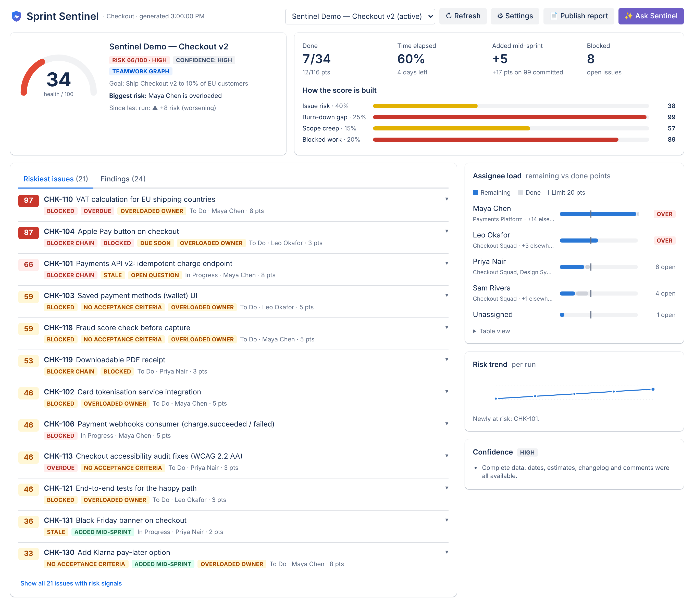
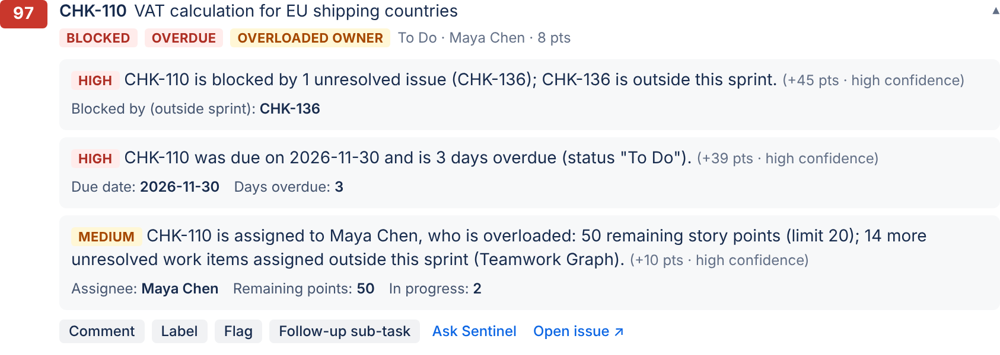
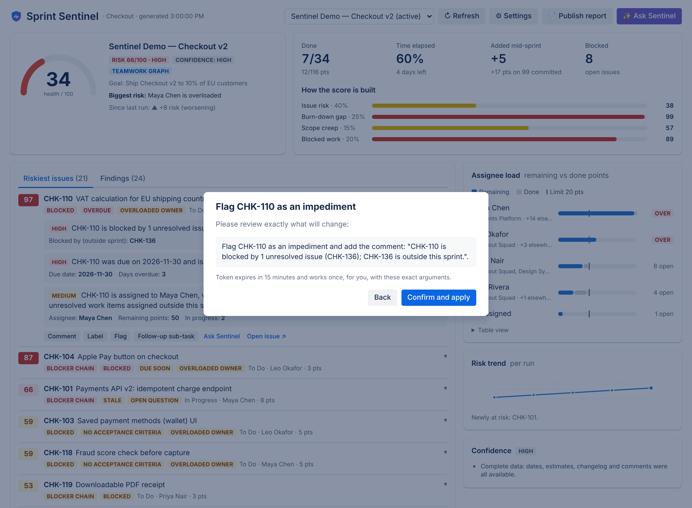
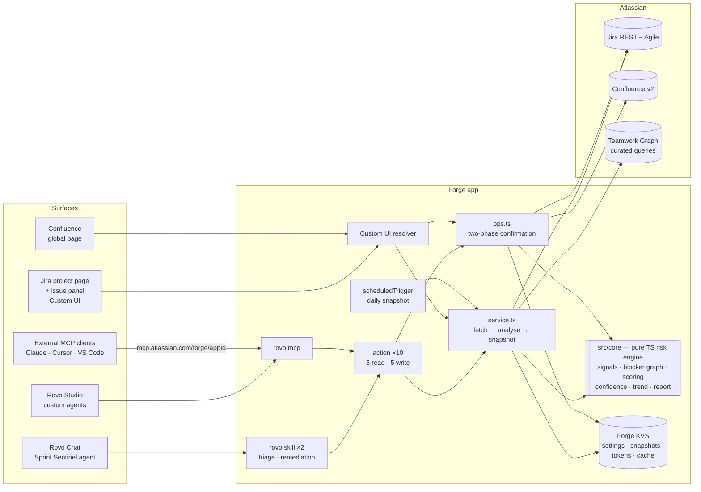

# Sprint Sentinel 🛡️

**An explainable, Rovo-powered delivery-risk copilot for Jira and Confluence — built on Atlassian Forge.**

Sprint Sentinel finds what will stop a sprint from landing — blockers and blocker chains, stale and overdue work,
overloaded people, scope creep, missing acceptance criteria and unanswered questions — scores it 0–100 with the
evidence behind every point, and lets you act on it (comment, label, flag, follow-up sub-task, Confluence report)
**only after you confirm**. The same capabilities are available as a Rovo agent, reusable Rovo skills, MCP tools for
Claude/Cursor/any MCP client, and a Jira dashboard.

> Codegeist 2026 entry · Category: **Apps for Software Teams** · Bonus: **Best Agents**, **Best app with Atlassian MCP**,
> **Best Teamwork Graph integration**, **Best Marketplace published app**.

| Dashboard | Evidence behind a risk | Human-in-the-loop confirmation |
|---|---|---|
|  |  |  |

<sub>Screenshots are rendered from the real risk engine on the demo dataset via the local mock bridge
(`npm run screenshots`). See [Screenshots to capture](#screenshots-to-capture) for the live-site shots used in the video.</sub>

---

## The problem

Sprints rarely fail on the last day — they fail on day 3, when a blocker outside the team goes unnoticed, one person
quietly carries half the points, "just one more" ticket slips in, and a question in a comment waits for an answer
nobody gives. The signals are all in Jira, but scattered across links, changelogs, comments and dates. Stand-ups
surface them late, and generic AI summaries can't be trusted because they don't show their work.

## The solution

Sprint Sentinel reads the sprint the way a seasoned delivery lead would and turns it into an **explainable risk score**:

- **11 risk signals**, each tied to concrete Jira data: blocked (links + Flagged), blocker chains, keystone blockers,
  circular dependencies, stale in-progress work, overdue, due-soon-not-started, missing acceptance criteria,
  unanswered questions, scope creep since sprint start (from the Sprint changelog), overloaded and unassigned work.
- **Per-issue risk (0–100)** and **sprint risk/health (0–100)** with a transparent breakdown
  (40% issue risk · 25% burn-down gap · 15% scope creep · 20% blocked work).
- **Confidence level with reasons** — sample size, estimate coverage, missing sprint dates, changelog/comment
  truncation, Teamwork Graph availability. **No invented data:** an empty sprint returns "no data", not a score.
- **Teamwork Graph context**: the teams each assignee belongs to and how much unresolved work they carry *outside*
  this sprint — hidden load a single-project view can't see.
- **Safe actions**: add a comment, add a label, flag an impediment, create a follow-up sub-task, publish a
  **Sprint Risk Report** Confluence page with a table and a **trend vs. the last run** — all through a server-enforced,
  single-use **confirmation token** (preview → explicit confirm → write).
- **Everywhere you work**: Rovo agent in Rovo Chat, 2 reusable `rovo:skill`s, 10 `action`s exposed as `rovo:mcp`
  tools (+ open-source [`skills/skill.md`](skills/skill.md) for third-party agents), a Jira project dashboard, a Jira
  issue panel, a Confluence portfolio page, and a daily snapshot that builds the trend line.

## Architecture



- **`src/core/`** — pure, deterministic TypeScript (time injected, no Forge APIs): `signals.ts`, `graph.ts`
  (blocker chains, keystones, Tarjan cycle detection), `analyze.ts` (scores, findings, confidence), `trend.ts`,
  `report.ts` (Confluence storage format), `confirm.ts` (token protocol), `summary.ts` (LLM-friendly payloads).
- **`src/jira`, `src/confluence`, `src/twg`** — thin adapters over a transport-agnostic `Requester` with
  JSON handling, **pagination** (offset and `nextPageToken`) and **429/5xx retry honouring `Retry-After`**.
- **`src/lib/forge.ts`** — the only file that touches `@forge/api` / `@forge/kvs` (asUser/asApp, requestJira,
  requestConfluence, requestTeamworkGraph).
- **`static/app`** — React Custom UI with hand-built SVG charts on Atlassian design tokens (light + dark).

## Forge modules used

| Module | Key | Purpose |
|---|---|---|
| `rovo:agent` | `sprint-sentinel-agent` | Chat copilot with prompt resource, starters, follow-ups, 10 actions, 2 skills |
| `rovo:skill` | `sprint-risk-triage`, `sprint-risk-remediation` | Reusable playbooks other agents can load |
| `rovo:mcp` | `sprint-sentinel-mcp` | Exposes all 10 actions as MCP tools |
| `action` ×10 | `analyze-sprint-risk`, `explain-issue-risk`, `get-assignee-load`, `list-sprints`, `get-risk-trend`, `add-risk-comment`, `add-risk-label`, `create-followup-subtask`, `flag-issue`, `publish-risk-report` | Read + confirmed-write tools |
| `jira:projectPage` | `sprint-sentinel-project-page` | Dashboard |
| `jira:issuePanel` | `sprint-sentinel-issue-panel` | Per-issue risk with evidence |
| `confluence:globalPage` | `sprint-sentinel-confluence-page` | Portfolio of watched sprints |
| `scheduledTrigger` | `daily-risk-snapshot` | Daily snapshot → trend line |
| `function` ×13 | | Handlers |

## Scopes and why (least privilege)

| Scope | Why |
|---|---|
| `read:jira-work` | Read sprint issues, changelog, comments, links, fields, create-meta |
| `write:jira-work` | Confirmed writes only: comment, label, flag, sub-task (and demo seeding) |
| `read:jira-user` | Assignee names; assignable users for demo seeding |
| `read:board-scope:jira-software`, `read:sprint:jira-software`, `read:project:jira` | Find Scrum boards and sprints |
| `write:sprint:jira-software` | Only the demo seeder: create/start the demo sprint and move issues into it |
| `read:space:confluence`, `read:page:confluence`, `write:page:confluence` | Find a space and publish the Sprint Risk Report |
| `read:graph:user:atlassian`, `read:graph:team:atlassian`, `read:graph:issue:jira` | Teamwork Graph curated queries: user → teams, user → assigned work items |
| `storage:app` | Settings, snapshots for the trend, single-use confirmation tokens, short-lived result cache |

No egress, no external services, no secrets — Sprint Sentinel is eligible for **Runs on Atlassian**.
All user-facing calls run **as the user** (`asUser`), so people only ever see data they already can.

## Setup (< 5 commands)

Prerequisites: Node 22, an Atlassian Cloud developer site with Jira (+ Confluence for reports, + Rovo for the agent),
and `npm i -g @forge/cli && forge login`.

```bash
git clone https://github.com/madhavzanwar/codegeist && cd codegeist
```

```bash
npm ci && npm --prefix static/app ci
```

```bash
SITE=your-site.atlassian.net ./scripts/ship.sh
```

`ship.sh` runs lint, typecheck, tests and the UI build, registers the app on first run (`forge register`), runs
`forge lint`, deploys to **production** and installs into Jira and Confluence on `$SITE`.

## Seed the demo data

**In the app (no token needed):** create a Jira project from the **Scrum** template → open its **Sprint Sentinel**
tab → click **🧪 Load demo sprint data**. The resumable seeder creates ~40 labelled issues (`sentinel-demo`) and
sub-tasks, a 3-hop blocker chain, a keystone blocker, blockers outside the sprint, an impediment flag, overdue and
due-soon work, questions in comments, unassigned work, a started sprint and five issues added **after** the sprint
started (scope creep). It runs as you, so it only does what you are allowed to do.

**From the terminal:**

```bash
JIRA_SITE=https://your-site.atlassian.net JIRA_EMAIL=you@example.com JIRA_API_TOKEN=*** npm run seed -- --project SEN --create-project
```

> The seeded sprint starts "now", so time-based signals reflect reality: **stale** needs real hours without updates
> (lower *Settings → Stale after* to e.g. 1 h for a demo) and the burn-down gap grows as the sprint advances.

## Using it

**Rovo agent** — open Rovo Chat → *Agents* → **Sprint Sentinel**, or click **✨ Ask Sentinel** in the dashboard.
Try: *"Is the SEN sprint on track?"*, *"Why is SEN-4 risky?"*, *"Who is overloaded?"*, *"Flag the blocked items"*,
*"Publish a Sprint Risk Report to the ENG space"*. Every write shows a preview and waits for your "yes".

**Jira dashboard** — project → *Sprint Sentinel* tab: health gauge, score breakdown, riskiest issues with evidence
and one-click (confirmed) actions, findings, assignee load with Teamwork Graph context, trend, confidence, settings.

**Issue panel** — on any issue, *Apps → Sprint risk* shows that issue's score and signals.

**MCP tools** — an admin enables external exposure (admin.atlassian.com → Apps → Sites → your site → Connected apps →
Sprint Sentinel → turn tools on). Then:

```bash
claude mcp add --transport http sprint-sentinel https://mcp.atlassian.com/forge/<APP_ID>
```

and load [`skills/skill.md`](skills/skill.md) into your agent. Inside Atlassian, the tools also appear in Rovo Studio
for custom agents.

## Quality

- `npm run lint` (ESLint + typescript-eslint), `npm run typecheck` (backend + UI), `npm run test:coverage`
  (Vitest, 88 tests, ~95% statements / 97% lines on `src/`), `npm run forge:lint` (Forge client-side linters
  offline) and `forge lint` once logged in. Results: [`docs/QA.md`](docs/QA.md). CI: `.github/workflows/ci.yml`.

## Limitations

- Scrum boards only (sprints); Kanban boards are ignored and reported as "no sprint".
- Up to 300 issues per sprint are analysed; changelog/comment truncation lowers confidence and is reported.
- Acceptance-criteria and question detection are heuristics (marked *medium confidence*).
- Overload capacity is a per-project setting (default 20 points, WIP 3), not real calendars/time off.
- Teamwork Graph API is in Preview: curated queries return at most 25 items (shown as "25+"); org-admin consent is
  needed for the graph scopes; when unavailable the app says so and continues without it.
- `rovo:skill` and `rovo:mcp` are Preview modules; external MCP exposure must be enabled by a site admin.
- Confluence reports need the app connected to Confluence on the same site (optional product).
- The daily snapshot runs as the app and only covers projects the app user can browse; dashboard and agent runs
  also record snapshots.
- Multi-product Forge apps can only be listed on Marketplace as paid apps (see `docs/MARKETPLACE.md`).

## Screenshots to capture

For the Devpost gallery and video (from the live site after seeding):
1. Jira project page — Sprint Sentinel dashboard (light) and dark mode.
2. Riskiest issue expanded showing evidence; Findings tab.
3. Confirmation modal (preview + token) and the resulting comment on the issue.
4. Issue panel on the keystone blocker.
5. Rovo Chat conversation with the Sprint Sentinel agent (analysis → flag with confirmation).
6. Published "Sprint Risk Report" Confluence page (table + trend).
7. Claude/Cursor calling the MCP tools.
8. Assignee load with Teamwork Graph teams / work elsewhere.
9. Confluence global page (portfolio).

## Credits

Built from scratch for Codegeist 2026. Reused open source and references are listed in [`CREDITS.md`](CREDITS.md).
License: MIT.
